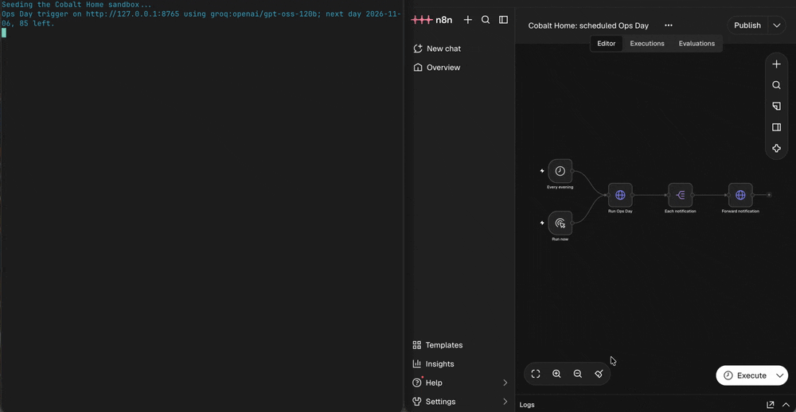

# retail-ops-agent

**Live demo (Replay Mode):** https://cobalt-home-ops.streamlit.app/

A working prototype of a forward-deployed engagement at **Cobalt Home**, a fictional home and
lifestyle retailer (6 Stores, an Online Shop, about 300 SKUs). All data is simulated.

See `GLOSSARY.md` for terms, `docs/adr/` for decisions and `.scratch/retail-ops-agent/spec.md`
for the spec.

## Develop

```sh
uv sync
make check       # ruff lint + format check, pyright, pytest
make dashboard   # Streamlit dashboard; opens in Replay Mode
make evals       # Golden Scenarios against real free-tier models; see evals/README.md
make record      # record Ops Days for Replay Mode
make deploy      # interactive wizard: deploy the dashboard to Streamlit Community Cloud
make trigger     # the local HTTP entry point n8n calls to run an Ops Day
make n8n         # local n8n in Docker, with the scheduled Ops Day workflow imported
```

Model keys are optional and free-tier only; see `.env.example`.

## Replay Mode

The dashboard opens in Replay Mode: it plays back Recordings of real Ops Days with no model, no key
and no network call, so a Visitor can step through each Ops Day stage by stage (Intake, Load,
Detection, Investigation, Actions). The Recordings live in `src/retail_ops_agent/recordings/` and
include a Defect day (Safe Fixes, a Quarantine and a corrected resend), a stockout risk with a
Reorder under the Auto-approval Limit, and a stockout risk whose Reorder waits for and gets
Approval. Each Recording names the model its agents ran on.

`make record` runs each Recording's seeded sandbox through the Ops Day boundary again and rewrites
its JSON. With a free-tier key in `.env.local` the agents use that model, paced for its rate limit;
without one, the offline scripted model stands in.

The sidebar switches to Live Mode, where each Visitor gets their own sandbox of Cobalt Home (BI
store, fake ERP, clock and Uploads), held only in their session's memory and seeded from the
generator with the offline scripted model. "Run day" processes the next day's Uploads with real
models; the Visitor can approve or reject Reorders, undo Audit Log entries, upload or edit a CSV of
their own (broken or malicious ones included) and reset. Ops Days first use the shared free-tier key
from the environment (`GROQ_API_KEY` or `GEMINI_API_KEY`), limited across every Visitor to
`LIVE_SHARED_RUNS` (40) Ops Days every `LIVE_SHARED_WINDOW_HOURS` (24); once that limit or the
provider's own is reached, the Visitor is asked for their own Groq or Gemini key, which is used for
their Ops Days only and never stored.

## Scheduled Ops Days with n8n

A local n8n in Docker triggers an Ops Day on a schedule and forwards the notifications it sends.
n8n is only a trigger: every rule lives in tested code behind the Ops Day boundary, and the
workflow (`n8n/workflows/ops-day.json`) has no code, branching or filtering nodes, which
`tests/test_n8n_trigger.py` checks.

```
Every evening (22:00) ─┐
                       ├─> Run Ops Day ──> Each notification ──> Forward notification
Run now (manual) ──────┘    POST /ops-day/run   split "notifications"   POST {"text": ...}
```



*One Ops Day triggered from n8n, at 10× speed (about 3 minutes in real time, as model calls are
paced for the free tier). Started with `make trigger ARGS="--seeded-days 5"`, so the first run
lands on the day with a Defect that has no Safe Fix.*

1. Start the trigger on the host. It seeds a Cobalt Home sandbox (Live Mode's, with its planted
   Defects and stockout risk) in memory, then runs the next day each time it is called. It uses a
   free-tier key from `.env.local` if there is one, else the offline scripted model. A real model's
   requests are paced to 10 a minute (`--rpm`), below Gemini's free-tier limit of 15, and retried
   when rate-limited, so one Ops Day takes a few minutes; the workflow waits up to 15.

   ```sh
   make trigger                       # http://127.0.0.1:8765
   make trigger ARGS="--host 0.0.0.0" # on Linux, so the n8n container can reach it
   ```

2. Start n8n and import the workflow (needs Docker):

   ```sh
   make n8n                           # n8n on http://localhost:5678
   ```

   Or start it with `docker compose -f n8n/docker-compose.yml up -d` and import
   `n8n/workflows/ops-day.json` from n8n's editor (Workflows → Import from File).

3. Open http://localhost:5678, set up the owner account, open "Cobalt Home: scheduled Ops Day",
   and press "Execute workflow" to run one Ops Day now, or activate it to run one every evening.

Each run's summary and every notification n8n forwards are printed by `make trigger`; the
forwarded ones are also at http://127.0.0.1:8765/inbox. By default n8n forwards to that local
inbox, a stand-in for Slack or Teams. To forward to a real chat, set `NOTIFY_WEBHOOK_URL` to an
incoming webhook that accepts `{"text": "..."}` before starting n8n:

```sh
NOTIFY_WEBHOOK_URL=https://hooks.slack.com/services/... docker compose -f n8n/docker-compose.yml up -d
```

The trigger's endpoints are `POST /ops-day/run` (run the next Ops Day; returns its day, a summary,
and the Uploader messages and alerts it sent, each with a ready-made `text`), `GET /health` (the
next day to run), and `POST`/`GET /inbox`. Once every generated day has run (90 by default,
`--days`), `/ops-day/run` answers 409; restart the trigger to start a fresh sandbox. A model outage
or rate limit answers 503 and the same day runs on the next trigger.

## Discovery and Hours Saved

`docs/discovery/` holds the simulated discovery documents: an engagement brief, personas, the
current manual processes step by step, and a baseline of manual timings. The baseline's
machine-readable form, `src/retail_ops_agent/baseline.json`, feeds the dashboard's Hours Saved:
the Audit Log entries of each baseline task's Action that no undo reversed, times its minutes each
time. Every timing is an assumption, marked as one, and shown next to the figure.

## The ERP MCP server

Cobalt Home's mock ERP runs as a standalone MCP server (ADR 0006). Its tools read Sales Channels,
SKUs, Suppliers and stock levels, and place, read and cancel Reorders. It is seeded from the same
generated Cobalt Home catalog as everything else, and its state lives in memory for as long as the
server runs.

```sh
uv run retail-ops-erp --seed 42   # speaks MCP over stdio
```

The agents and the Action policy never call these tools directly. They go through the ERP client
interface (`retail_ops_agent.erp.ErpClient`), which has two implementations: `McpErpClient`, which
talks to this server, and `InMemoryErp`, the fake used in tests and sandboxes. One contract suite
(`tests/test_erp_contract.py`) runs against both so the fake can't drift from the server. A real
engagement swaps this server for one that wraps the Client's own ERP (NetSuite, Odoo and so on)
and exposes the same tools.

### Connecting from Claude Desktop

Add the server to Claude Desktop's `claude_desktop_config.json` (Settings → Developer → Edit
Config), using the absolute path to your clone, and restart Claude Desktop:

```json
{
  "mcpServers": {
    "cobalt-home-erp": {
      "command": "uv",
      "args": ["--directory", "/absolute/path/to/retail_ops_agent", "run", "retail-ops-erp", "--seed", "42"]
    }
  }
}
```

If Claude Desktop can't find `uv`, use its absolute path (`which uv`) as `command`. You can then ask
things like "Which SKUs does Store ST01 have fewer than 10 of?" or "Place a Reorder of 12 CH-0001
for ST01, then cancel it." The placing and cancelling tools are marked as writes, so the client
asks you before it runs them. Any other MCP client that can launch a stdio server works the same
way, and you can browse the tools with the MCP Inspector:

```sh
npx @modelcontextprotocol/inspector uv run retail-ops-erp --seed 42
```
